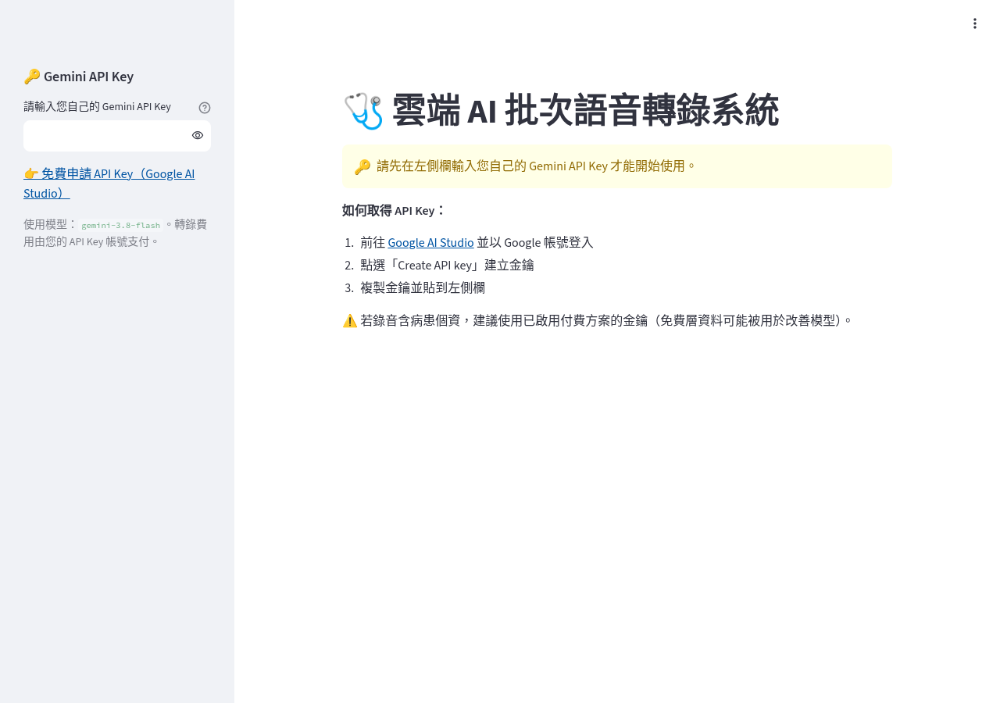

# 🩺 MedTransMeet：雲端 AI 批次語音轉錄系統

以 Streamlit + Google Gemini（`gemini-3.8-flash`）將醫療會議錄音批次轉錄為繁體中文（台灣用語），並強化醫療資訊術語（FHIR、HL7、DICOM、SNOMED CT、LOINC、ICD-10、PACS 等）的辨識。

## 🌐 線上 Demo
👉 **https://medtransmeet.streamlit.app/**

使用時請在左側欄填入您自己的 Gemini API Key（[免費申請](https://aistudio.google.com/apikey)），轉錄費用由您的帳號支付。



## 功能
- 一次上傳多個音訊檔（m4a / mp3 / wav / mp4），依序自動轉錄
- 透過 Gemini Files API 上傳，支援長時間會議錄音（不受 inline 20MB 限制）
- 轉錄完成後立即刪除 Gemini 雲端上的音訊檔，不留存醫療資料
- 可自訂醫療提示詞
- 轉錄後自動撰寫文章（會議紀錄／新聞稿／專題文章／網站文章，提示詞可自訂）
- 網站文章可上傳參考文章，自動分析成「寫作風格指南」（可修改、下載沿用），撰寫時依指南風格產出
- 下載 Word（`.docx`，含文章與逐字稿原文）或文字檔，支援單檔與全部合併
- 使用者自行填入 Gemini API Key，費用由使用者自己的帳號支付，網站不保存金鑰

## 部署到 Streamlit Community Cloud
1. 到 https://share.streamlit.io 選 **Create app**，Repository 選本 repo，Branch `main`，Main file `app.py`
2. 按 **Deploy**（不需設定 Secrets，使用者會在網頁左側欄填入自己的 API Key）

## 以 Docker 部署（選用）
另附 `Dockerfile`（Streamlit 監聽 8501 埠）：
```bash
docker build -t medtransmeet .
docker run -p 8501:8501 medtransmeet
```
部署到 Hugging Face Spaces（Docker SDK）時需額外：
- 在 Space 的 `README.md` 開頭加上 `sdk: docker` 與 `app_port: 8501`
- 在 `.streamlit/config.toml` 的 `[server]` 加上 `enableXsrfProtection = false`（HF 以 iframe 嵌入，否則上傳會出現 403）

## 本機執行
```bash
pip install -r requirements.txt
streamlit run app.py
```

## 隱私提醒
若錄音含病患個資，請使用 Gemini API 付費方案（免費層資料可能被用於改善模型）。
